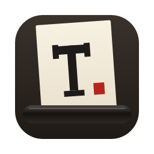

<p align="center"></p>

# TypeWriterX

A small, fast word processor that behaves like a real typewriter. Nothing is ever deleted: you overtype, paint over with Tipp-Ex, or feed in a fresh sheet.

Built with [Tauri](https://tauri.app) and a dependency-free TypeScript + Canvas core. The macOS app is about 3.4 MB. It uses the system web view instead of bundling a browser, so it starts quickly and stays light on memory. The same core runs on Windows and in the browser.

## Features

**The machine**
- **One typeface per document**, chosen when you insert paper: Special Elite, Courier Prime, Cutive Mono, Sometype Mono or IBM Plex Mono. All are openly licensed.
- **Pitch**: Pica (10 cpi), Elite (12) or Micro (15). Paper sizes from A4 / Letter / Legal down to index cards.
- **Backspace moves the carriage back and never erases.** Type over a letter to overstrike it, for example `/` over `=` for ≠.
- **Real carriage behaviour**: a margin bell, a margin lock where keys pile up or jam, margin release, tab stops, half-space and half-line moves, and Shift + Return for a carriage return without a line feed.
- **Line-spacing lever**: 1, 1½, 2, 2½ or 3 lines.
- A **moving carriage view** where the paper slides past a fixed type point, or a **fixed paper view**.

**Ink that responds to your touch**

Mac keyboards can't sense key pressure, so TypeWriterX uses stand-ins, each of which can be switched off in Settings:
- **Hold to darken.** A letter lands the moment you press the key, then settles darker the longer you hold it. A quick tap prints faint and a firm press prints bold. *Adaptive* mode learns your normal touch, so your everyday typing sits mid-range.
- **Ribbon wear.** Each ribbon band fades with use, with a slight unevenness along its length. Use *Machine › Change Ribbon* to fit a fresh one.
- **Jitter, typebar misalignment and uneven strikes.** Each document gets its own "machine" with consistently slightly-off letters, plus a little per-strike variation.

**Ribbon bands**
- 1–4 bands of any colour (black/red, navy, purple copying ink and others), selected with the ribbon lever (⌘1–⌘4).
- **Stencil** position (⌘5) embosses the paper without ink.
- Inks multiply, so overstruck colours mix the way real ink does.

**Corrections, typewriter-style**
- **Tipp-Ex brush** (⌘K): drag over letters to paint them out, then type over the dried fluid. Coverage, brush size and colour are adjustable. A thin coat lets a ghost of the old letters show through.
- **Correction tape** (⇧⌘K) covers the next letter you strike.
- Undo is there if you want it. Turn on **Purist mode** to remove it.

**Free movement: the line release**

Press ⌘L to release the ratchet. A two-finger scroll then rolls the platen and slides the carriage freely, so you can place text anywhere on the page.
- **Locks**: platen (vertical), carriage (horizontal) and paper rotation.
- **Two-finger twist** (or ⌥⌘← / ⌥⌘→) rotates the paper in the machine, so you type at an angle. ⌥⌘A straightens it.
- **Click to position** the type point, with optional snapping to half-steps.
- Without the line release, scrolling moves in ratchet notches, one line or one character at a time.

**Files**
- `.twx` documents: compact JSON, double-click to open.
- **Export to PDF.** Each page is an exact image of the paper (every overstrike, shade and colour), with an invisible, selectable text layer so you can search and copy.
- **Export to PNG** (one image per sheet) and **plain text**. Overstrikes keep the last letter typed, and anything painted out is dropped.
- Your current document is kept between launches, so you resume where you left off.

**Sound**

Key clacks, the margin bell, the carriage return and the platen ratchet are all synthesised in code, with no audio files. Each can be adjusted or muted.

## Keys & gestures

| | |
|---|---|
| Hold a key longer | Strike darker |
| Backspace | Carriage back one space (nothing is erased) |
| Return / ⇧ Return | Carriage return with / without line feed |
| ← → ↑ ↓ | Move carriage / roll platen (⌥ for half steps) |
| Two-finger scroll | Roll the platen and slide the carriage |
| Pinch | Zoom |
| Two-finger twist, ⌥⌘← ⌥⌘→ | Rotate the paper (⌥⌘A straightens) |
| ⌥ + scroll | Look around without moving anything |
| ⌘L | Line release (free movement) |
| ⌥⌘P / ⌥⌘C / ⌥⌘R | Lock platen / carriage / rotation |
| ⇧⌘M | Margin release |
| ⌘K / ⇧⌘K | Tipp-Ex brush / correction tape |
| ⌘1–⌘4, ⌘5 | Ribbon band, stencil |
| ⇧⌘N, ⌘[ ⌘] | Feed new sheet, previous / next sheet |
| ⌘E, ⇧⌘E, ⌥⌘E | Export PDF, PNG, text |
| ⇧⌘F | Focus mode |
| ⌘/ | All shortcuts |

## Building

You need [Node.js](https://nodejs.org) 20+ and [Rust](https://rustup.rs) 1.90+. On macOS you also need the Xcode Command Line Tools.

```bash
npm install
npm run app:dev      # run the desktop app with live reload
npm run app:build    # build TypeWriterX.app / installers into src-tauri/target/release/bundle
```

### Web version

The same code runs in any modern browser. Saving uses the File System Access API where available, and downloads elsewhere.

```bash
npm run dev:web      # http://localhost:1420
npm run build:web    # static site in dist/
```

### Windows

Run `npm run app:build` on Windows, or push a `v*` tag and the GitHub Actions **Release** workflow builds macOS and Windows installers into a draft release.

## Project layout

```
src/core      document model, the typewriter mechanism, strike force, preferences
src/render    canvas renderer, ink and paper textures, font loading
src/input     keyboard (with hold timing) and trackpad / mouse
src/audio     synthesised sounds
src/io        platform layer (desktop / browser) and PDF / PNG / text export
src/ui        toolbar, settings drawer, dialogs, menus
src-tauri     the small Rust shell (file I/O, native menu, "Open With")
```

## Licence

MIT. See [LICENSE](LICENSE) and [NOTICE](NOTICE). The bundled fonts keep their own licences (SIL OFL 1.1 and Apache 2.0), which are included in `public/fonts/licenses`.
